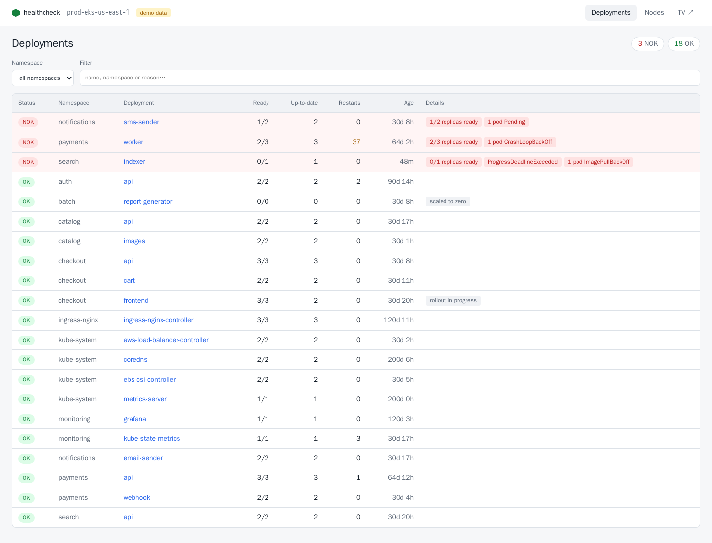
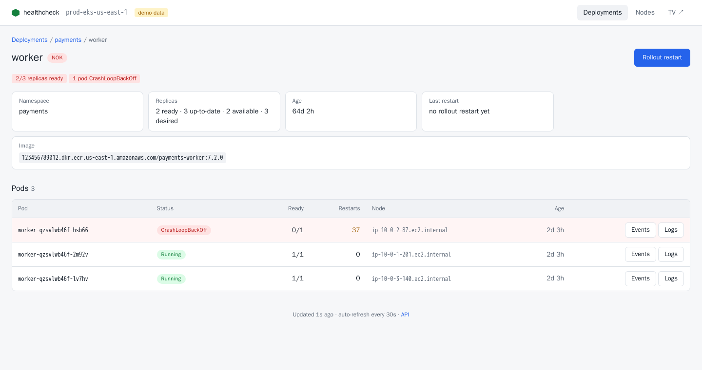
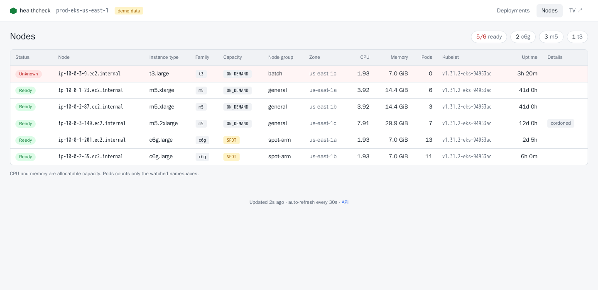
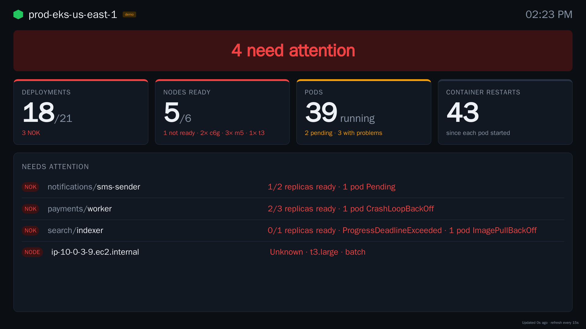
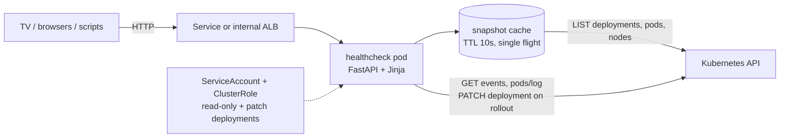
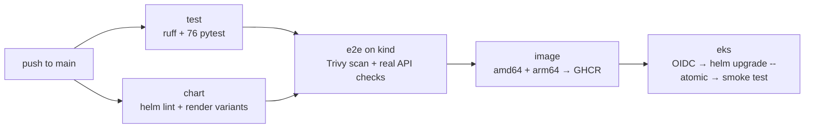

# eks-healthcheck

[](https://github.com/daniloiskilo84/eks-healthcheck/actions/workflows/ci.yml)

**A small web app that runs inside an EKS cluster and answers "is everything OK?" at a glance**: every deployment sorted by OK/NOK, the pods behind each one with their events and logs, a one-click rollout restart, node health (instance type, family, Spot/On-Demand, uptime) and a full-screen dashboard made for the TV on the team's wall.

Every push to `main` is linted, unit-tested, tested end to end on a real Kubernetes API (kind), scanned, built for amd64 + arm64 and deployed to EKS with Helm, using GitHub OIDC (no AWS keys stored anywhere).

| Deployments, NOK first | One deployment: pods, events, logs, rollout |
|---|---|
|  |  |
| **Nodes** | **TV dashboard** |
|  |  |

<sub>Screenshots from the built-in demo cluster (`DEMO_MODE=true`).</sub>

## What it does

| Page | What you see | Why |
|---|---|---|
| `/deployments` | Every deployment, **NOK on top**, with ready/up-to-date replicas, restarts, age and the reasons | The one screen to open during an incident |
| `/deployments/<ns>/<name>` | Its pods with status, restarts and node; **Events** and **Logs** per pod (container picker, `--previous`, tail size); **Rollout restart** button | Go from "NOK" to the cause without `kubectl` |
| `/nodes` | Ready/NotReady/pressure, instance type, **family**, **Spot/On-Demand**, node group, zone, allocatable CPU/memory, pods, kubelet, **uptime** | Spot reclaims and bad nodes show up here first |
| `/tv` | Big, dark, auto-refreshing: overall state, four tiles and the list of what needs attention | Readable across the room on a 1080p TV |
| `/api/*` | The same data as JSON ([OpenAPI docs](#api) at `/api/docs`) | Scripts, chat bots, other dashboards |

### When is a deployment NOK?

| Rule | Example reason shown |
|---|---|
| Fewer ready replicas than desired | `2/3 replicas ready` |
| `Progressing=False` (the rollout gave up) | `ProgressDeadlineExceeded` |
| `ReplicaFailure=True` (e.g. quota) | `FailedCreate` |
| Any of its pods stuck in a state that never heals by itself | `1 pod CrashLoopBackOff`, `2 pods ImagePullBackOff`, `CreateContainerConfigError`, `OOMKilled`, `Evicted` |
| A pod `Pending` for more than 5 minutes (configurable) | `1 pod Pending` |

The pod rule matters: when a new version crashes during a rolling update, the old pods keep serving, so `ready == desired` and the deployment *looks* fine while the rollout is stuck forever. Scaled to zero and "rollout in progress" are shown as notes, not failures.

Nodes are NOK when `Ready` is `False`/`Unknown` or when `MemoryPressure`, `DiskPressure`, `PIDPressure` or `NetworkUnavailable` is true. Cordoned nodes get a note. Instance type, capacity type and node group come from the standard EKS managed node group labels, with Karpenter labels as fallback.

## How it works



Design decisions worth calling out:

- **One LIST per TTL, however many people are watching.** The TV, a dozen tabs and the API all read one cached snapshot (3 LIST calls). Concurrent requests wait for the fetch in progress instead of starting their own.
- **Stale beats blank.** If the API server stops answering, the last good snapshot keeps being served with a warning banner, so the TV shows "data from 2 minutes ago", not a stack trace.
- **Least privilege, checked in CI.** The ClusterRole can only `get/list/watch` pods, nodes, events and deployments, read `pods/log` and `patch` deployments. The `patch` permission disappears when rollout is disabled. The e2e test asserts the ServiceAccount *cannot* delete pods, create deployments, read secrets or patch nodes.
- **Rollout restart is exactly `kubectl rollout restart`**: it patches the `kubectl.kubernetes.io/restartedAt` annotation on the pod template, so pods are replaced following the deployment's own strategy (maxSurge/maxUnavailable, PDBs). The endpoint requires an `X-Requested-With` header (blocks CSRF from other sites), refuses namespaces the app does not watch, and every call is logged with user, client IP and timestamp.
- **Hardened pod**: non-root UID 10001, read-only root filesystem, all capabilities dropped, `RuntimeDefault` seccomp, no privilege escalation, memory limit. Image scanned with Trivy in CI.
- **No frontend build.** Server-rendered HTML plus ~200 lines of plain JavaScript. Nothing to `npm audit`, and it works on the TV's browser.
- **Demo mode** ships a realistic fake cluster (CrashLoopBackOff worker, missing ECR image, unschedulable pod, half-done rollout, a NotReady node, a cordoned node, Spot Graviton nodes). Useful for screenshots, UI work and showing the project without AWS.

## Run it

### 1. Demo, no cluster needed

```bash
make demo        # or: docker build -t eks-healthcheck:dev . && docker run --rm -p 8080:8080 -e DEMO_MODE=true eks-healthcheck:dev
open http://localhost:8080        # TV: http://localhost:8080/tv
```

### 2. Local Kubernetes (kind), real API

```bash
make kind-up kind-deploy
kubectl -n healthcheck port-forward svc/hc-eks-healthcheck 8080:80
make e2e         # the same end-to-end checks CI runs
```

Running the app on your laptop against the current kube context also works: `pip install -r requirements.txt && uvicorn app.main:create_app --factory --port 8080` (it falls back to `~/.kube/config` when not in a cluster).

### 3. EKS, through the pipeline



`ci.yml` runs on every push and pull request; `deploy.yml` starts only when CI succeeded on `main`. The `eks` job is skipped until the repository is configured, so the pipeline stays green on forks:

| Where | Name | Value |
|---|---|---|
| Variables | `EKS_CLUSTER_NAME` | e.g. `prod-eks` |
| Variables | `AWS_REGION` | e.g. `us-east-1` |
| Secrets | `AWS_DEPLOY_ROLE_ARN` | IAM role GitHub assumes through OIDC |
| Environment | `production` | add required reviewers to gate deploys |

One-time AWS setup (the role needs `eks:DescribeCluster` and an EKS access entry):

```bash
# Trust policy: only this repo's main branch / production environment can assume the role
#   "token.actions.githubusercontent.com:sub": "repo:<owner>/eks-healthcheck:environment:production"
aws eks create-access-entry --cluster-name prod-eks --principal-arn "$ROLE_ARN"
# The chart creates a ClusterRole/Binding, so the deployer needs cluster-admin on this cluster
aws eks associate-access-policy --cluster-name prod-eks --principal-arn "$ROLE_ARN" \
  --policy-arn arn:aws:eks::aws:policy/AmazonEKSClusterAdminPolicy --access-scope type=cluster
```

Make the GHCR package public (or add `imagePullSecrets`) so the nodes can pull it. To expose the UI inside the VPC, enable the internal ALB ingress in [`deploy/values-production.yaml`](deploy/values-production.yaml).

## Configuration

Helm values (env var in parentheses):

| Value | Default | |
|---|---|---|
| `clusterName` (`CLUSTER_NAME`) | `my-eks-cluster` | shown on every page |
| `namespaces` (`NAMESPACES`) | all | only these namespaces |
| `excludeNamespaces` (`EXCLUDE_NAMESPACES`) | none | hidden everywhere, logs and rollout included |
| `rollout.enabled` (`ROLLOUT_ENABLED`) | `true` | `false` removes the button, the endpoint and the RBAC `patch` |
| `cacheTtlSeconds` (`CACHE_TTL_SECONDS`) | `10` | how often the API server is listed |
| `refresh.pageSeconds` / `refresh.tvSeconds` | `30` / `15` | auto-refresh of pages and TV |
| `pendingGraceSeconds` (`PENDING_GRACE_SECONDS`) | `300` | Pending longer than this is a problem |
| `logTailLines` (`LOG_TAIL_LINES`) | `300` | default lines in the log viewer (max 2000) |
| `auth.enabled`, `auth.username`, `auth.password` / `auth.existingSecret` | off | HTTP Basic auth; probes stay open |
| `demoMode` (`DEMO_MODE`) | `false` | fake cluster, no API calls, no ClusterRole |

For production, prefer putting it behind an SSO-aware ingress (ALB with Cognito/OIDC, or oauth2-proxy) over Basic auth.

## API

| Method | Path | |
|---|---|---|
| GET | `/api/summary` | counts, healthy flag, NOK deployments and nodes (what the TV shows) |
| GET | `/api/deployments?namespace=` | all deployments, NOK first |
| GET | `/api/deployments/{ns}/{name}` | one deployment with its pods |
| POST | `/api/deployments/{ns}/{name}/rollout` | rollout restart (header `X-Requested-With: healthcheck`) |
| GET | `/api/nodes` | nodes, NOK first |
| GET | `/api/pods/{ns}/{pod}/events` | pod events, newest first |
| GET | `/api/pods/{ns}/{pod}/logs?container=&tail=&previous=` | plain-text logs |
| GET | `/healthz`, `/readyz` | liveness; readiness checks the API server |

## Project layout

```
app/
  health.py      # the OK/NOK rules (pure functions, most of the tests)
  service.py     # snapshot cache, stale fallback, namespace filters
  k8s.py         # real backend: official Kubernetes client → app.models
  demo.py        # fake cluster with realistic failures
  main.py        # FastAPI routes, API shapes, auth, rollout
  templates/ static/
chart/eks-healthcheck/   # Helm chart: Deployment, Service, Ingress, RBAC, Secret
deploy/                  # production values used by the pipeline
scripts/e2e-kind.sh      # end-to-end checks against a real cluster
tests/                   # 76 tests: rules, client mapping, cache, HTTP API
```

## Roadmap

- `/metrics` for Prometheus (NOK deployments, NotReady nodes) so alerts don't depend on someone watching the TV
- Watch API (informers) instead of periodic LIST for very large clusters
- Several clusters on one TV
- Slack/Teams notification when something turns NOK

## License

MIT
